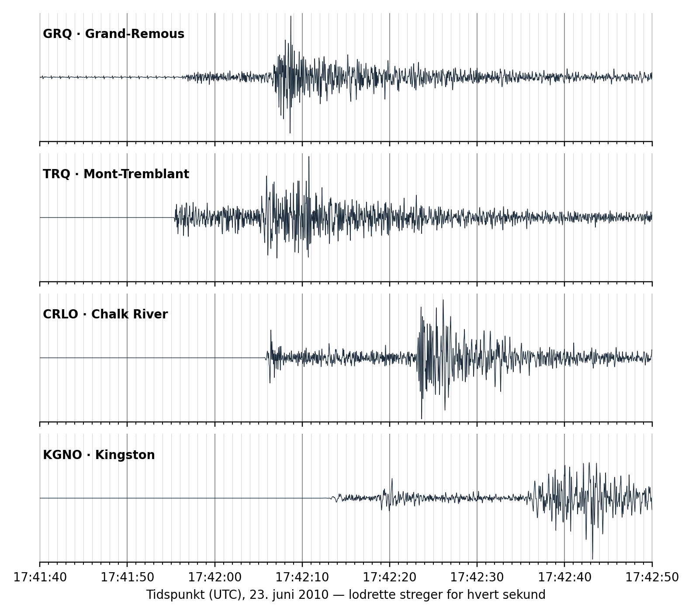

**Dato:** \_\_\_\_\_\_\_\_\_\_\_\_\_\_\_\_\_\_\_\_ &nbsp;&nbsp;&nbsp;&nbsp; **Gruppe / navne:** \_\_\_\_\_\_\_\_\_\_\_\_\_\_\_\_\_\_\_\_\_\_\_\_\_\_\_\_\_\_\_\_\_\_\_\_\_\_\_\_

## Om øvelsen

Den 23. juni 2010 lidt over kl. 13:41 lokal tid (17:41 UTC) rystede jorden i det sydlige Québec i Canada. Skælvet kunne mærkes i Ottawa og Montréal og flere hundrede kilometer væk. Seismografer i hele regionen registrerede det. I denne øvelse får I de rigtige seismogrammer fra fire af stationerne, og ud fra dem skal I finde ud af, hvor jordskælvet skete — præcis som seismologerne gør.

## Baggrund

Et jordskælv sender flere slags bølger ud fra hypocentret (stedet i dybet, hvor bruddet sker). Punktet på overfladen lige over hypocentret er epicentret.

- P-bølger (primære bølger) er trykbølger, der svinger frem og tilbage i bølgens retning. De er hurtigst og kommer først. I jordskorpen bevæger de sig med ca. 6,2 km/s.
- S-bølger (sekundære bølger) er tværbølger, der svinger på tværs af bølgens retning. De er langsommere, ca. 3,65 km/s, og kommer derfor senere — men de er ofte kraftigere.

Jo længere væk stationen er, jo større bliver forspringet for P-bølgen. Tidsforskellen $\Delta t$ mellem S- og P-bølgens ankomst fortæller derfor, hvor langt der er til jordskælvet. Bølgerne har tilbagelagt den samme afstand $D$:

$$\Delta t = t_S - t_P = \frac{D}{v_S} - \frac{D}{v_P}$$

Løser man den for $D$, får man:

$$D = \Delta t \cdot \frac{v_P \cdot v_S}{v_P - v_S} = \Delta t \cdot \frac{\text{6,2} \cdot \text{3,65}}{\text{6,2} - \text{3,65}}\ \text{km/s} \approx \Delta t \cdot \text{8,9}\ \text{km/s}$$

Afstanden fra én station giver en cirkel, som epicentret ligger på. Med tre stationer eller flere kan man finde det punkt, hvor cirklerne skærer hinanden.

## Data

@fig-seismogrammer viser den lodrette rystelse ved fire stationer i det canadiske seismografnet. Tiden står i UTC (verdenstid), og der er en tynd lodret streg for hvert sekund.

{#fig-seismogrammer width="100%"}

| Station | Sted | Bredde (°N) | Længde (°V) |
|:-:|:---|:-:|:-:|
| GRQ | Grand-Remous, Québec | 46,606 | 75,859 |
| TRQ | Mont-Tremblant, Québec | 46,218 | 74,551 |
| CRLO | Chalk River, Ontario | 46,038 | 77,380 |
| KGNO | Kingston, Ontario | 44,227 | 76,493 |

: Seismografstationernes placering. I Google Earth skrives fx GRQ som «46.606, -75.859» (punktum som decimaltegn og minus for vestlig længde). {#tbl-1}

::: {.callout-tip}
## Tip

Stationerne findes også som en færdig fil, [seismografstationer.kml](seismografstationer.kml), der kan åbnes direkte i Google Earth Pro.
:::

## Fremgangsmåde

1. Find for hver station det tidspunkt, hvor P-bølgen ankommer: det første sted, hvor sporet begynder at svinge tydeligt. Aflæs tidspunktet så præcist som muligt (på et halvt sekund nær), og skriv det i @tbl-2.
2. Find tidspunktet, hvor S-bølgen ankommer: det sted, hvor udsvingene pludselig bliver meget større igen. Skriv det i @tbl-2.
3. Åbn Google Earth Pro, og sæt et mærke ved hver af de fire stationer (eller åbn kml-filen).
4. Når I har beregnet afstandene (se databehandlingen), så tegn en cirkel om hver station: vælg linealværktøjet, fanen *Cirkel*, sæt centrum i stationen, og træk ud, til radius svarer til den beregnede afstand.
5. Find det sted, hvor cirklerne skærer hinanden, eller hvor de kommer tættest på hinanden. Sæt et mærke, og aflæs koordinaterne og navnet på den nærmeste by.

## Registrering af målinger

| Station | P-bølge ankommer (kl.) | S-bølge ankommer (kl.) | $\Delta t = t_S - t_P$ (s) |
|:-:|:-:|:-:|:-:|
| GRQ | 17:41: | 17:42: | |
| TRQ | 17:41: | 17:42: | |
| CRLO | 17:42: | 17:42: | |
| KGNO | 17:42: | 17:42: | |

: Aflæste ankomsttider. {#tbl-2}

## Databehandling

1. Beregn tidsforskellen $\Delta t$ for hver station, og beregn afstanden til jordskælvet med formlen $D = \Delta t \cdot \text{8,9}\ \text{km/s}$. Skriv resultaterne i @tbl-3.
2. Tegn cirklerne i Google Earth (fremgangsmåden trin 4–5). Hvor ligger epicentret ifølge jeres målinger? Notér koordinaterne.
3. Beregn, hvornår jordskælvet skete. P-bølgen har brugt tiden $D/v_P$ på at nå frem til stationen, så:

   $$t_0 = t_P - \frac{D}{\text{6,2}\ \text{km/s}}$$

4. Sammenlign med den officielle placering og det officielle tidspunkt (læreren udleverer dem, eller slå skælvet op hos USGS: «M 5.2 – 29 km NNE of Val-des-Monts, Canada»). Beregn, hvor mange kilometer jeres epicenter ligger fra det officielle. Mål afstanden med linealen i Google Earth.

| Station | $\Delta t$ (s) | Afstand $D$ (km) | Udløsningstidspunkt $t_0$ |
|:-:|:-:|:-:|:-:|
| GRQ | | | |
| TRQ | | | |
| CRLO | | | |
| KGNO | | | |
| **Jeres epicenter** | Bredde: | Længde: | Nærmeste by: |

: Beregnede afstande og jordskælvets tidspunkt. {#tbl-3}

## Journalspørgsmål

1. Forklar forskellen på P- og S-bølger, og hvorfor P-bølgen altid kommer først.
2. Hvorfor skal man bruge mindst tre stationer for at bestemme epicentret? Hvad ville I vide, hvis I kun havde én eller to?
3. Skar jeres cirkler hinanden i ét punkt? Hvis ikke: hvad kan grunden være? Tænk på aflæsningen af ankomsttiderne, at bølgernes fart varierer med bjergarterne, og at jordskælvet skete i ca. 20 km dybde.
4. Afstandene I har beregnet, er egentlig afstanden til *hypocentret*, ikke til epicentret. Hvorfor betyder det mest for den station, der ligger tættest på?
5. S-bølger kan ikke bevæge sig gennem væsker. Forklar, hvordan seismologer har brugt det til at vise, at Jordens ydre kerne er flydende.
6. Jordskælvet skete midt på den nordamerikanske plade, langt fra nærmeste pladegrænse. Hvordan kan der overhovedet komme jordskælv her? Sammenlign med jordskælv ved pladegrænser.
7. Moderne jordskælvsvarsling (fx i Japan og Mexico) udnytter, at P-bølgen kommer før den kraftige S-bølge. Hvor mange sekunders varsel ville byer 150 og 300 km væk få? Er det nok til at gøre en forskel?

## Om denne udgave

Bygger på øvelsen «Lokalisering af jordskælv» fra naturgeografi C (Geolink, *Pladetektonik og naturkatastrofer*, 2025/26), der igen bygger på en elevøvelse fra Natural Resources Canada (*Earthquake activity 7: Locate the Earthquake*, 2011) om det samme jordskælv, og på en ældre Google Earth-udgave af øvelsen. Ændret i forhold til originalerne:

- Den ældre Google Earth-udgave placerede seismogrammerne fra de canadiske stationer på opdigtede stationer i Nordeuropa. Øvelsen bruger nu de rigtige stationer, og eleverne kan sammenligne deres epicenter med det rigtige.
- Seismogrammerne er nye: de rigtige registreringer fra NRCan's åbne seismiske data (Canadian National Seismograph Network), hentet og tegnet til denne vejledning med fælles tidsakse og en streg pr. sekund. Den tidligere figur var en skitse, hvor tidsforskellene ikke passede med stationernes afstande.
- Stationerne er valgt 80–200 km fra skælvet. Længere væk kommer den første P-bølge gennem den øverste kappe og er hurtigere end 6,2 km/s, så den simple model passer dårligere.
- Formlen er udledt i teksten, og beregning af jordskælvets tidspunkt er nyt. P- og S-bølgernes hastigheder (6,2 og 3,65 km/s) er de samme som i originalen.
