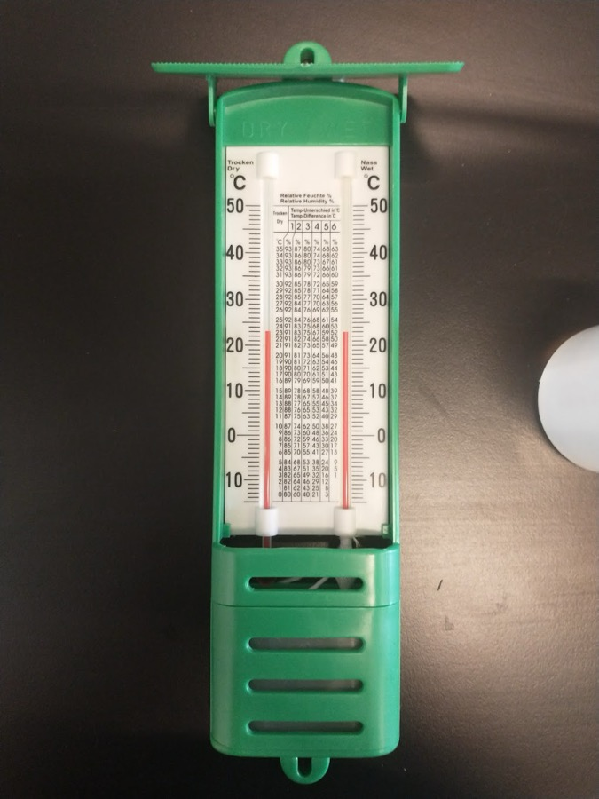

**Dato:** \_\_\_\_\_\_\_\_\_\_\_\_\_\_\_\_\_\_\_\_ &nbsp;&nbsp;&nbsp;&nbsp; **Gruppe / navne:** \_\_\_\_\_\_\_\_\_\_\_\_\_\_\_\_\_\_\_\_\_\_\_\_\_\_\_\_\_\_\_\_\_\_\_\_\_\_\_\_

## Om øvelsen

Luften indeholder altid noget usynlig vanddamp, men hvor meget? I denne øvelse måler I luftfugtigheden inde i klasselokalet og udenfor med et psykrometer. Ud fra målingerne finder I den relative og den absolutte luftfugtighed og dugpunktet, og til sidst beregner I, hvor mange gram vanddamp der er i luften i klasselokalet.

## Baggrund

Jo varmere luften er, jo mere vanddamp kan den højst indeholde. Sammenhængen kan vises med dugpunktskurven — se @tbl-1 og simuleringen *Dugpunkt* på smbi.dk.

- Den absolutte luftfugtighed er, hvor mange gram vanddamp der faktisk er i 1 m³ luft (g/m³).
- Den maksimale luftfugtighed er, hvor mange gram vanddamp 1 m³ luft højst kan indeholde ved den aktuelle temperatur. Så er luften *mættet*.
- Den relative luftfugtighed er den absolutte luftfugtighed i procent af den maksimale:

$$\text{relativ luftfugtighed} = \frac{\text{absolut luftfugtighed}}{\text{maksimal luftfugtighed}} \cdot 100\ \%$$

- Dugpunktet er den temperatur, luften skal køles ned til, før den bliver mættet, og vanddampen begynder at fortætte til dråber — dug, tåge eller skyer.

Et psykrometer består af to termometre. Det ene er almindeligt (*tørtermometeret*). Det andet har en stofstrømpe om kuglen, der suger vand op fra en lille beholder (*vådtermometeret*). Fra den våde strømpe fordamper der vand, og fordampningen bruger energi, så vådtermometeret bliver koldere. Jo tørrere luften er, jo hurtigere fordamper vandet, og jo større bliver forskellen mellem de to termometre. Ud fra tørtemperaturen og forskellen kan man aflæse den relative luftfugtighed i tabellen mellem termometrene.

{#fig-psykrometer width="45%"}

| T (°C) | Maks. (g/m³) | T (°C) | Maks. (g/m³) | T (°C) | Maks. (g/m³) |
|:-:|:-:|:-:|:-:|:-:|:-:|
| −5 | 3,4 | 7 | 7,7 | 19 | 16,3 |
| −4 | 3,7 | 8 | 8,3 | 20 | 17,2 |
| −3 | 3,9 | 9 | 8,8 | 21 | 18,3 |
| −2 | 4,2 | 10 | 9,4 | 22 | 19,4 |
| −1 | 4,5 | 11 | 10,0 | 23 | 20,5 |
| 0 | 4,8 | 12 | 10,6 | 24 | 21,7 |
| 1 | 5,2 | 13 | 11,3 | 25 | 23,0 |
| 2 | 5,6 | 14 | 12,0 | 26 | 24,3 |
| 3 | 5,9 | 15 | 12,8 | 27 | 25,7 |
| 4 | 6,4 | 16 | 13,6 | 28 | 27,1 |
| 5 | 6,8 | 17 | 14,4 | 29 | 28,7 |
| 6 | 7,3 | 18 | 15,3 | 30 | 30,3 |

: Maksimal luftfugtighed — så mange gram vanddamp kan 1 m³ luft højst indeholde ved temperaturen T (mættet over vand). Tabellen er dugpunktskurven skrevet som tal. {#tbl-1}

## Hypotese

Hvor tror I, luften indeholder flest gram vanddamp pr. m³ — inde eller ude? Og hvor er den *relative* luftfugtighed højest? Skriv jeres bud ned, før I måler.

::: {.callout-note}
## Materialer (pr. gruppe)

- To psykrometre (ét inde og ét ude) — eller ét, der flyttes ud efter indemålingen
- Destilleret vand
- Målebånd eller laserafstandsmåler (til klasselokalet)
- Ur eller stopur
:::

## Fremgangsmåde

### Måling inde og ude

1. Fyld vandbeholderen under vådtermometeret med destilleret vand. Kontrollér, at strømpen om vådtermometeret er helt gennemvædet.
2. Hæng psykrometeret op inde i klasselokalet, væk fra radiatorer, vinduer med sol og steder, hvor mange mennesker står tæt.
3. Hæng et andet psykrometer op udenfor i skyggen, gerne i ca. 1,5–2 m højde og i læ for regn.
4. Vent mindst en halv time, så termometrene har indstillet sig.
5. Aflæs tør- og vådtemperaturen på begge psykrometre, og skriv dem i @tbl-2. Aflæs vådtermometeret først, og hold hænder og ånde væk fra termometrene, mens I aflæser.
6. Beregn forskellen mellem tør- og vådtemperaturen, og aflæs den relative luftfugtighed i tabellen på psykrometeret.

### Klasselokalets rumfang

7. Mål klasselokalets længde, bredde og loftshøjde, og skriv målene i @tbl-3. Er lokalet ikke kasseformet, så del det op i kasser.

::: {.callout-tip}
## Tip

Er forskellen mellem tør- og vådtemperaturen større end tabellen på psykrometeret går til, er luften meget tør. Spørg læreren, eller brug en psykrometertabel på nettet.
:::

## Registrering af målinger

| | Inde | Ude |
|:---|:-:|:-:|
| Tidspunkt | | |
| Tørtemperatur $T_\text{tør}$ (°C) | | |
| Vådtemperatur $T_\text{våd}$ (°C) | | |
| Forskel $T_\text{tør} - T_\text{våd}$ (°C) | | |
| Relativ luftfugtighed, aflæst (%) | | |
| Vejret ude (sol, skyer, regn, vind) | — | |

: Psykrometermålinger inde og ude. {#tbl-2}

| Længde (m) | Bredde (m) | Højde (m) |
|:-:|:-:|:-:|
| | | |

: Klasselokalets mål. {#tbl-3}

## Databehandling

1. Find den maksimale luftfugtighed ved tørtemperaturen i @tbl-1 for både inde og ude.
2. Beregn den absolutte luftfugtighed:

   $$\text{absolut luftfugtighed} = \frac{\text{relativ luftfugtighed}}{100\ \%} \cdot \text{maksimal luftfugtighed}$$

3. Find dugpunktet: led i @tbl-1 efter den temperatur, hvor den maksimale luftfugtighed er lig med jeres absolutte luftfugtighed.
4. Beregn klasselokalets rumfang og den samlede masse af vanddamp i luften i lokalet:

   $$V = \text{længde} \cdot \text{bredde} \cdot \text{højde} \qquad m_\text{vanddamp} = \text{absolut luftfugtighed} \cdot V$$

5. Hvor meget mere vanddamp kunne luften i lokalet indeholde, før den blev mættet?

$$m_\text{mangler} = (\text{maksimal} - \text{absolut luftfugtighed}) \cdot V$$

| | Inde | Ude |
|:---|:-:|:-:|
| Maksimal luftfugtighed (g/m³) | | |
| Absolut luftfugtighed (g/m³) | | |
| Dugpunkt (°C) | | |
| Klasselokalets rumfang $V$ (m³) | | — |
| Vanddamp i lokalet $m_\text{vanddamp}$ (g) | | — |
| Plads til mere vanddamp $m_\text{mangler}$ (g) | | — |

: Beregnede værdier. {#tbl-4}

6. Afsæt jeres to målinger (tørtemperatur, absolut luftfugtighed) som punkter på en dugpunktskurve, fx i simuleringen *Dugpunkt* eller i et diagram, I selv laver ud fra @tbl-1. Tegn for hvert punkt en vandret pil hen til kurven, og aflæs dugpunktet. Passer det med jeres beregning?

## Journalspørgsmål

1. Forklar forskellen på absolut og relativ luftfugtighed. Hvorfor kan luften ude have en højere relativ luftfugtighed end luften inde, selv om den indeholder færre gram vanddamp pr. m³?
2. Forklar, hvorfor vådtermometeret viser en lavere temperatur end tørtermometeret, og hvorfor forskellen er størst, når luften er tør.
3. Hvad sker der, når udeluften om vinteren bliver lukket ind og varmet op til stuetemperatur? Hvad sker der med den relative luftfugtighed — og hvorfor oplever mange tør luft indendørs om vinteren?
4. Hvorfor dugger et koldt glas eller en kold rude? Brug begrebet dugpunkt og jeres egne tal.
5. Hvor kommer vanddampen i klasselokalet fra? Hvad ville der ske med jeres resultat, hvis I målte sidst i et modul med 28 elever og lukkede vinduer?
6. Forklar, hvordan luft bliver kølet ned til dugpunktet, når den stiger op i atmosfæren, og hvordan der derved dannes skyer og nedbør. Inddrag begreberne tøradiabatisk og fugtadiabatisk temperaturændring.
7. Vurdér fejlkilderne: aflæsningsnøjagtighed på termometrene, om strømpen var våd nok, om psykrometeret hang i sol eller træk, og hvor længe I ventede.

## Om denne udgave

Bygger på beskrivelsen «Måling af luftfugtighed» på Geolink (naturgeografi C, *Vand og jord*, modulet om nedbørsdannelse, 2025/26) og NF-udgaven fra *Mad til milliarder* 2025/26 med aflæsningsvejledningen. Der fandtes ingen egentlig øvelsesvejledning, kun en kort beskrivelse og en liste over spørgsmål. Ændret og nyt i forhold til originalen:

- Fremgangsmåden er skrevet ud trin for trin, med placering af psykrometrene og opmåling af lokalet.
- Ny tabel over maksimal luftfugtighed (@tbl-1), beregnet med Magnus-formlen for mættet damptryk over vand (WMO) og idealgasloven, så dugpunktet og den absolutte luftfugtighed kan findes uden dugpunktskurven. Tabellen på psykrometeret er kontrolleret med psykrometerformlen: dens værdier passer med et ikke-ventileret psykrometer.
- Originalens spørgsmål (relativ og absolut luftfugtighed, dugpunkt, vanddamp i lokalet) er samlet i databehandlingen. Nyt: hvor meget vanddamp der mangler, før luften er mættet, og journalspørgsmål om indeklima, dug og skydannelse.
- Lærerens eget foto af psykrometeret.
