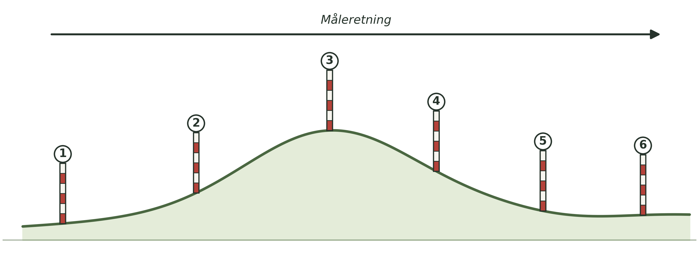
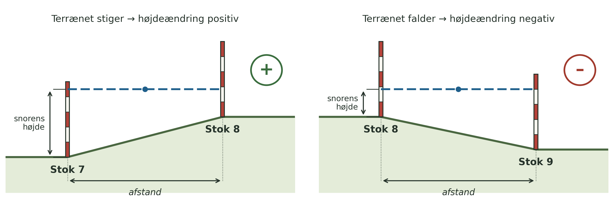

**Dato:** \_\_\_\_\_\_\_\_\_\_\_\_\_\_\_\_\_\_\_\_ &nbsp;&nbsp;&nbsp;&nbsp; **Gruppe / navne:** \_\_\_\_\_\_\_\_\_\_\_\_\_\_\_\_\_\_\_\_\_\_\_\_\_\_\_\_\_\_\_\_\_\_\_\_\_\_\_\_\_\_\_\_

## Om øvelsen

I dag skal I opmåle et terrænprofil, så I bagefter kan tegne terrænformerne langs profilet.

Øvelsen udføres på volden ved den gamle swimmingpool øst for gymnasiet, samt på plænerne omkring den.

{#fig-terraen}

## Fremgangsmåde

1. Sæt landmålerstokkene i en lige række hen over terrænet, i den retning I vil måle profilet (se @fig-terraen).
2. Spænd snoren mellem de to forreste stokke, og brug vaterpasset til at sikre, at snoren hænger helt vandret (i vater).
3. Mål den vandrette afstand mellem de to stokke med målebåndet, og skriv den ind i skemaet.
4. Mål højden fra jorden op til snoren ved hver af de to stokke, med meterstokken eller det korte målebånd (se @fig-maalemetode).

{#fig-maalemetode}

5. Beregn højdeændringen som forskellen mellem de to målte højder. Husk fortegn: positiv (+), hvis terrænet stiger, og negativ (–), hvis det falder.
6. Er højdeforskellen mellem to stokke større end stokkenes egen højde, skal I sætte en eller flere ekstra stokke ind imellem, så I kan måle højdeændringen i mindre trin.
7. Flyt jer én strækning frem, og gentag målingerne, indtil hele profilet er opmålt.

::: {.callout-tip}
## Tip

Dobbelttjek at snoren er helt i vater, før I aflæser højden på stokken — en skæv snor giver en forkert højdeændring. Læs af i øjenhøjde, ikke skråt oppefra eller nedefra.
:::

::: {.callout-note}
## Materialer (pr. gruppe)

- 5–6 rød- og hvidstribede landmålerstokke
- Et flere meter langt stykke snor
- Et vaterpas
- En meterstok
- Et 30 m målebånd
- Et 3 m målebånd (eller et symålebånd)
:::

## Registrering af målinger

| Strækning | A (1-2) | B (2-3) | C (3-4) | D (4-5) | E (5-6) |
|:---|:---:|:---:|:---:|:---:|:---:|
| Afstand (m) | | | | | |
| Snorens højde på første stok (cm) | | | | | |
| Snorens højde på anden stok (cm) | | | | | |
| **Beregnet højdeændring (cm)** — HUSK FORTEGN! | | | | | |

: Måleresultater. Husk fortegn ved højdeændringerne! {#tbl-1}

*Sætter I ekstra stokke ind undervejs, tilføjes ekstra kolonner i hånden.*

## Databehandling

1. Beregn for hver stok den samlede vandrette afstand fra startstokken og den samlede højde i forhold til startstokken ved at lægge strækningernes afstande og højdeændringer sammen (husk fortegn):

$$x_n = \sum_{i=1}^{n} \text{afstand}_i \qquad h_n = \sum_{i=1}^{n} \Delta h_i$$

| Stok | 1 | 2 | 3 | 4 | 5 | 6 |
|:---|:-:|:-:|:-:|:-:|:-:|:-:|
| Samlet afstand fra stok 1 (m) | 0 | | | | | |
| Højde i forhold til stok 1 (cm) | 0 | | | | | |

: Profilets punkter, udledt af @tbl-1. {#tbl-2}

2. Tegn terrænprofilet på millimeterpapir eller i et regneark: afstand på x-aksen og højde på y-aksen. Vælg målestok for begge akser, og angiv dem på tegningen. Beregn den *overhøjning*, I har brugt:

$$\text{Overhøjning} = \frac{\text{lodret målestok}}{\text{vandret målestok}}$$

3. Beregn hældningen for hver strækning i procent og i grader, og find den stejleste strækning:

$$\text{Hældning (\%)} = \frac{\Delta h}{\text{afstand}} \cdot 100 \qquad \text{Hældning (°)} = \tan^{-1}\!\left(\frac{\Delta h}{\text{afstand}}\right)$$

(Husk at regne $\Delta h$ og afstanden om til samme enhed.)

4. Sæt navne på terrænformerne langs profilet (fx vold, skråning, flade).

## Journalspørgsmål

1. Beskriv profilet med fagbegreber: hvor er terrænet fladt, hvor er det stejlt, og hvor stor er den samlede højdeforskel?
2. Volden ved den gamle swimmingpool er menneskeskabt. Hvordan kan man i terrænet kende forskel på en menneskeskabt terrænform og en naturlig, fx en morænebakke eller en åskrænt?
3. Hvorfor tegner man ofte terrænprofiler med overhøjning? Hvilke fordele og ulemper har det for læseren?
4. Hvilke fejlkilder er der ved metoden (fx en snor, der ikke er helt vandret, en skæv stok eller en strækning, der ikke følger profillinjen), og hvordan forplanter en fejl på én strækning sig til resten af profilet?
5. Sammenlign jeres profil med højdekurverne på et topografisk kort eller Danmarks Højdemodel over samme sted. Stemmer de overens?
6. Hvordan kunne man bruge samme metode til at opmåle fx et kystprofil eller en ådal, og hvad ville man kunne lære af at gentage målingen et år senere?
