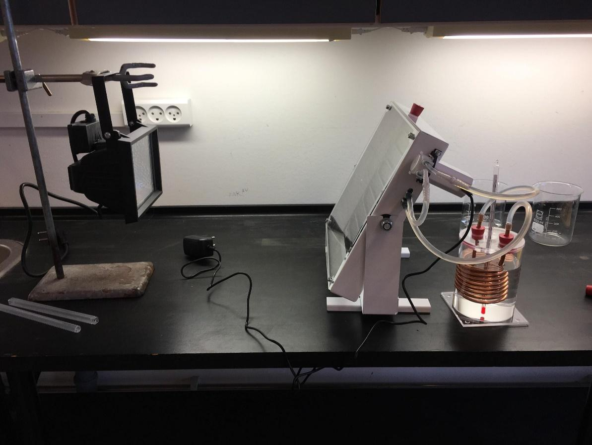

**Dato:** \_\_\_\_\_\_\_\_\_\_\_\_\_\_\_\_\_\_\_\_ &nbsp;&nbsp;&nbsp;&nbsp; **Gruppe / navne:** \_\_\_\_\_\_\_\_\_\_\_\_\_\_\_\_\_\_\_\_\_\_\_\_\_\_\_\_\_\_\_\_\_\_\_\_\_\_\_\_

## Om øvelsen

En solfanger omsætter solens stråling til varme, som fx kan bruges til varmt brugsvand eller fjernvarme. I denne øvelse belyser I en lille solfanger med en kraftig lampe i 30 minutter og måler, hvor meget vandet i en lagertank bliver opvarmet. Ud fra det beregner I solfangerens **nyttevirkning**: hvor stor en del af den indstrålede energi der ender som varme i vandet.

## Baggrund

Solfangerens absorber er en sortmalet metalplade med påloddede kobberrør. Den sorte flade absorberer det meste af lyset og bliver varm. Bagsiden er isoleret, og på forsiden sidder en gennemsigtig akrylplade, der mindsker varmetabet ved konvektion. En lille cirkulationspumpe fører vand rundt i et lukket kredsløb: gennem kobberrørene i solfangeren og videre gennem en kobberspiral i lagertanken. Spiralen er en **varmeveksler** — den afgiver varmen til vandet i tanken uden at de to vandmængder blandes. Tanken svarer til varmtvandsbeholderen i et hus.

{#fig-opstilling width="85%"}

**Energi ind.** Lampens stråling måles med et pyranometer som en *bestrålingsstyrke* $\varphi$ i W/m² (watt pr. kvadratmeter). Den energi, der rammer absorberen i tiden $t$, er

$$Q_\text{ind} = \varphi \cdot A \cdot t$$

hvor $A$ er absorberens areal i m² og $t$ er tiden i sekunder. Det giver energien i joule (J), fordi 1 W = 1 J/s.

**Energi opsamlet.** Den energi, vandet i tanken har modtaget, findes ud fra temperaturstigningen:

$$Q_\text{vand} = c_\text{vand} \cdot m_\text{vand} \cdot \Delta T$$

hvor $c_\text{vand}$ = 4,18 kJ/(kg·K) er vands specifikke varmekapacitet, $m_\text{vand}$ er vandets masse i kg, og $\Delta T$ er temperaturstigningen. En stigning på 1 °C er det samme som en stigning på 1 K, så $\Delta T$ kan regnes direkte i °C.

**Nyttevirkning.** Forholdet mellem den nyttige energi og den tilførte energi:

$$\eta = \frac{Q_\text{vand}}{Q_\text{ind}} \cdot 100\ \%$$

## Hypotese

Hvor stor tror I, solfangerens nyttevirkning er? Skriv et tal og en kort begrundelse, før I går i gang.

::: {.callout-important}
## Sikkerhed

Lampen bliver meget varm, og lyset er skarpt — kig ikke direkte ind i den, og rør ikke ved skærmen. Hæng lampen stabilt op i holderen, *før* den tændes. Pas på med vand nær stikkontakter og ledninger, og tør spild op med det samme.
:::

::: {.callout-note}
## Materialer (pr. gruppe)

- Solfanger med slanger og cirkulationspumpe
- Lagertank af plexiglas med låg og kobberspiral
- Kraftig lampe («solen») og stativfod med klemme
- Pyranometer
- Termometer (eller temperaturføler)
- Bægerglas, 500 mL, og vægt
- Målebånd eller lineal
- Stopur (fx på mobilen)
:::

## Fremgangsmåde

### Fyld det lukkede kredsløb

Rørene i solfangeren, kobberspiralen og slangerne skal være fyldt med vand, der bliver i et lukket kredsløb under hele forsøget.

1. Tag den slange af kobberspiralen, der går til den nederste studs på solfangeren.
2. Hæld vand i et bægerglas, og sæt den løse slangeende ned under vandoverfladen.
3. Start pumpen ved at sætte stikket i stikkontakten (der er ingen knap). Vandet pumpes op i slangen og videre gennem solfangeren og kobberspiralen.
4. Når der kommer en vandstråle ud af kobberspiralen, er systemet fyldt. Sluk pumpen, og sæt slangen på spiralen igen.

### Klargør tanken og mål lyset

1. Sæt bægerglasset på vægten, tryk «tara», og afvej 600 g koldt vand. Hæld vandet forsigtigt over i lagertanken.
2. Sæt låget med kobberspiralen på tanken, og stik termometeret ned gennem det midterste hul.
3. Hæng lampen op i holderen, så den er 60 cm fra solfangeren og lyser vinkelret på absorberen.
4. Tænd lampen kort, og mål bestrålingsstyrken med pyranometeret på fem steder på absorberen: midten og de fire hjørner. Skriv tallene i @tbl-1, og sluk lampen igen.

### Selve forsøget

1. Tænd pumpen, og lad vandet cirkulere et minut. Rør forsigtigt rundt i tanken med termometeret, og aflæs temperaturen. Skriv den i @tbl-2 ud for 0 s.
2. Tænd lampen, og start stopuret samtidig.
3. Aflæs temperaturen i tanken hvert 5. minut i 30 minutter. Rør forsigtigt rundt med termometeret ca. 1 minut før hver aflæsning.
4. Sluk lampen og pumpen efter 1800 s. Rør ikke ved lampen, før den er kølet af.

::: {.callout-tip}
## Tip

Lad lampen, afstanden og vinklen være helt uændret under hele forsøget. Hvis I skubber til stativet, ændrer I bestrålingsstyrken — og så passer målingen i @tbl-1 ikke længere.
:::

## Registrering af målinger

| Målested | Midte | Øverst venstre | Øverst højre | Nederst venstre | Nederst højre |
|:---|:-:|:-:|:-:|:-:|:-:|
| $\varphi$ (W/m²) | | | | | |

: Bestrålingsstyrken på absorberen, målt med pyranometer. {#tbl-1}

Absorberens areal: $A$ = 0,0756 m² &nbsp;&nbsp;&nbsp;&nbsp; Vandets masse i tanken: $m_\text{vand} =$ \_\_\_\_\_\_\_\_ kg &nbsp;&nbsp;&nbsp;&nbsp; Afstand lampe–solfanger: \_\_\_\_\_\_\_\_ cm

| Tid (s) | 0 | 300 | 600 | 900 | 1200 | 1500 | 1800 |
|:---|:-:|:-:|:-:|:-:|:-:|:-:|:-:|
| Temperatur (°C) | | | | | | | |

: Temperaturen af vandet i lagertanken. {#tbl-2}

## Databehandling

1. Beregn gennemsnittet af de fem målinger af bestrålingsstyrken i @tbl-1:

$$\bar{\varphi} = \frac{\varphi_1 + \varphi_2 + \varphi_3 + \varphi_4 + \varphi_5}{5}$$

2. Lav et (x,y)-punktdiagram i Excel eller Google Sheets med tiden i s på x-aksen og temperaturen i °C på y-aksen. Navngiv akserne, og skriv enhederne på. Er kurven en ret linje, eller flader den ud?
3. Beregn den energi, der har ramt absorberen i forsøgets 1800 s. Husk at omregne fra J til kJ:

$$Q_\text{ind} = \bar{\varphi} \cdot A \cdot t$$

4. Beregn temperaturstigningen $\Delta T = T_{1800} - T_0$ og den energi, vandet i tanken har modtaget:

$$Q_\text{vand} = c_\text{vand} \cdot m_\text{vand} \cdot \Delta T$$

5. Beregn nyttevirkningen $\eta$ i procent, og sammenlign med jeres hypotese.
6. Beregn den gennemsnitlige effekt, solfangeren har leveret til vandet, og sammenlign med den effekt, der ramte absorberen:

$$P_\text{vand} = \frac{Q_\text{vand}}{t} \qquad P_\text{ind} = \bar{\varphi} \cdot A$$

7. Beregn til sidst nyttevirkningen for de første 10 minutter (0–600 s) og for de sidste 10 minutter (1200–1800 s) hver for sig. Bliver solfangeren bedre eller dårligere, efterhånden som vandet bliver varmt?

| Størrelse | Værdi | Enhed |
|:---|:-:|:-:|
| Gennemsnitlig bestrålingsstyrke $\bar{\varphi}$ | | W/m² |
| Energi ind $Q_\text{ind}$ (0–1800 s) | | kJ |
| Temperaturstigning $\Delta T$ (0–1800 s) | | °C |
| Energi opsamlet $Q_\text{vand}$ (0–1800 s) | | kJ |
| Nyttevirkning $\eta$ (0–1800 s) | | % |
| Effekt ind $P_\text{ind}$ | | W |
| Effekt til vandet $P_\text{vand}$ | | W |
| Nyttevirkning de første 10 min | | % |
| Nyttevirkning de sidste 10 min | | % |

: Beregnede værdier. {#tbl-3}

## Journalspørgsmål

1. Forklar med jeres egne ord, hvordan solfangeren omsætter strålingsenergi til varme i vandet. Brug begreberne absorption, konvektion og varmeveksler.
2. Hvor er den energi blevet af, der ikke endte i vandet i tanken? Nævn mindst tre steder, energien kan være tabt.
3. Hvorfor falder nyttevirkningen typisk, efterhånden som vandet bliver varmere? Brug jeres beregning fra punkt 7 i databehandlingen.
4. Vurdér fejlkilderne: Hvad betyder det for resultatet, at bestrålingsstyrken ikke er lige stor over hele absorberen, at vandet i slangerne og kobberet også bliver varmet op, og at termometeret kun måler ét sted i tanken? Bliver nyttevirkningen over- eller undervurderet?
5. Ville det gøre en forskel, om absorberen var hvid i stedet for sort? Forklar med begrebet albedo.
6. Lampen giver en bestrålingsstyrke på nogle hundrede W/m². En klar sommerdag i Danmark kan solen give op til ca. 1000 W/m² på en flade, der vender mod solen, mens en overskyet dag giver langt mindre. Hvad betyder det for, hvor meget varme en solfanger på et hustag kan levere — og hvorfor er det et problem, at behovet for varme er størst om vinteren?
7. Sammenlign en solfanger med et solcelleanlæg: Hvilken energiform leverer de hver især, og hvorfor har solfangere typisk en højere nyttevirkning end solceller?
8. Danmark har nogle af verdens største solvarmeanlæg, der leverer varme til fjernvarmenettet (fx ved Silkeborg og Dronninglund). Find et af dem i Google Earth, og mål det omtrentlige areal. Hvilke fordele og ulemper er der ved at bruge et stort landareal til solvarme frem for fx landbrug?

## Om denne udgave

Bygger på «Solfanger_forsøg.docx» fra naturgeografi C, 2b 2025/26 (forløbet *Energi og teknologi*), og på det tilhørende arbejdsark om energi, effekt og virkningsgrad. Fremgangsmåden, mængderne (600 g vand, 60 cm, 30 minutter) og absorberarealet på 0,0756 m² er beholdt. Ændret i forhold til originalen:

- «Varmepumpe» i originalens teoriafsnit er rettet til *cirkulationspumpe* — solfangeren har ingen varmepumpe.
- «Strålingskapacitet» er rettet til *bestrålingsstyrke*, og $C_v$ er skrevet som $c_\text{vand}$ med enheden kJ/(kg·K).
- Pyranometermålingen, som originalen nævner i materialelisten men ikke i fremgangsmåden, er gjort til et trin med fem målepunkter og et gennemsnit.
- Kolonnen med omregning til kelvin er taget ud: en temperaturstigning er den samme i °C og K.
- Databehandlingen er udvidet med graf, effekt og nyttevirkning i første og sidste del af forsøget. Originalens overskrifter «Fejlkilder» og «Konklusion» er blevet til journalspørgsmål.
- Leverandørens produktfotos er ikke genbrugt; kun lærerens eget foto af opstillingen.
